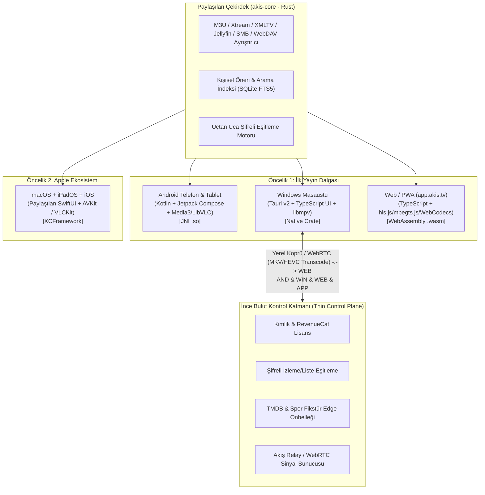

# Akış — Küresel Yayın, Yasal Uyum, Ürün Dönüşümü ve Çoklu Platform Mühendislik Planı

> [!IMPORTANT]
> **Temel Stratejik Karar:** Mevcut uygulama şu haliyle yalnızca kişisel kullanım içindir; mağazalara (Google Play, Microsoft Store, Apple App Store) yüklendiği anda **marka ihlali**, **üçüncü taraf web kazıma**, **açılış duvarı** ve **GPL/LGPL lisans** riskleri nedeniyle reddedilir. Bu plan, mevcut güçlü medya motorunu koruyarak ürünü **yasal, mağaza dostu, yüksek kârlı ve 5 platformda (Android Telefon/Tablet, Windows, Web, macOS, iPadOS) ölçeklenebilir bir "Evrensel Kişisel Medya & Yayın Merkezi"ne** dönüştürmek için hazırlanmıştır.

---

## 1. Yasal Engel ve Mağaza Reddi Temizliği (Yayına Çıkmadan Zorunlu Faz)

Mevcut kod tabanında yapılan doğrudan inceleme sonucunda, mağaza yayınından ve ödeme altyapısı onayından önce çözülmesi zorunlu **6 kritik mühendislik/hukuk engeli** tespit edilmiştir:

| # | Mevcut Risk & Kod Konumu | Neden Yasal / Mağaza Engeli? | Mühendislik Çözümü |
| :--- | :--- | :--- | :--- |
| **1** | **Üçüncü Taraf Marka ve Ses Taklidi**<br>• [netflix-n.svg](file:///Users/tahay/Documents/projelerim/Ak%C4%B1%C5%9F%20Program%C4%B1/public/netflix-n.svg), [icon.svg](file:///Users/tahay/Documents/projelerim/Ak%C4%B1%C5%9F%20Program%C4%B1/public/icon.svg)<br>• [index.html](file:///Users/tahay/Documents/projelerim/Ak%C4%B1%C5%9F%20Program%C4%B1/public/index.html#L20-L36) (`alt="Netflix N simgesi"`)<br>• [app.js](file:///Users/tahay/Documents/projelerim/Ak%C4%B1%C5%9F%20Program%C4%B1/public/app.js#L84), [AkisTheme.kt](file:///Users/tahay/Documents/projelerim/Ak%C4%B1%C5%9F%20Program%C4%B1/android/app/src/main/java/com/akis/iptv/ui/AkisTheme.kt#L106-L121) (`NetflixLeft`, `NetflixRight`, `NetflixDiagonal`)<br>• [akis_mark.xml](file:///Users/tahay/Documents/projelerim/Ak%C4%B1%C5%9F%20Program%C4%B1/android/app/src/main/res/drawable/akis_mark.xml) ve açılış sesi (`launch.mp3` / `akis_ident.ogg`) | Tescilli Netflix "N" şerit amblemi, 80 çubuklu spektrum ve ses markası taklidi doğrudan **Ticari Marka & Görünüm İhlali (Trade Dress / Soundmark)** ve **Apple Guideline 4.1 (Copycat) / Google Play Taklitçilik** sebebiyle anında hesap banına yol açar. | Tüm platformlarda 100% özgün **Akış** amblemi (akış çizgileri / "A" oynat ikonu), özgün renk aksanı seçenekleri (ör. koyu sinema slate + mercan/amber/yakut tema) ve özgün sentezlenmiş telifsiz açılış sesi/animasyonuna geçiş. |
| **2** | **İzinsiz Web Kazıma (Scraping) & Resmi Olmayan API'ler**<br>• [discovery.py](file:///Users/tahay/Documents/projelerim/Ak%C4%B1%C5%9F%20Program%C4%B1/discovery.py#L12-L75) & [Discovery.kt](file:///Users/tahay/Documents/projelerim/Ak%C4%B1%C5%9F%20Program%C4%B1/android/app/src/main/java/com/akis/iptv/data/Discovery.kt#L80-L130) (`netflix.com/tudum/top10`, `v3-cinemeta.strem.io`)<br>• [sports.py](file:///Users/tahay/Documents/projelerim/Ak%C4%B1%C5%9F%20Program%C4%B1/sports.py#L14) & [SportsGuide.kt](file:///Users/tahay/Documents/projelerim/Ak%C4%B1%C5%9F%20Program%C4%B1/android/app/src/main/java/com/akis/iptv/sports/SportsGuide.kt#L20) (`sporekrani.com`)<br>• [AkisApp.swift](file:///Users/tahay/Documents/projelerim/Ak%C4%B1%C5%9F%20Program%C4%B1/native/AkisApp.swift#L141) | Başka şirketlerin web sitelerini HTML kazıyarak ticari bir uygulamada göstermek **5846 FSEK, Haksız Rekabet ve ToS ihlali** oluşturur; ayrıca tek HTML değişikliğinde uygulama çöker ve yalnızca Türkiye pazarına sıkışır. | • **Keşif:** Kendi hafif Edge Proxy sunucumuz üzerinden **TMDB Resmi Ticari API** (zorunlu TMDB atıf metniyle) ve bölge bazlı trendler (`TR`, `US`, `GB`, `DE`, vb.).<br>• **Spor & Yayın Rehberi:** Kazımayı kaldırıp **XMLTV EPG** desteği + isteğe bağlı lisanslı fikstür API'si (**TheSportsDB** veya **API-Sports** ticari planı). |
| **3** | **İlk Açılışta "Boş Oturum Duvarı" (Store Review Reddi)**<br>• [SetupAndSettings.kt](file:///Users/tahay/Documents/projelerim/Ak%C4%B1%C5%9F%20Program%C4%B1/android/app/src/main/java/com/akis/iptv/ui/SetupAndSettings.kt#L28)<br>• [`renderSetup()`](file:///Users/tahay/Documents/projelerim/Ak%C4%B1%C5%9F%20Program%C4%B1/public/app.js#L177) | Google ve Apple inceleme uzmanları Xtream kullanıcı adı/parolasına sahip değildir. Açılışta hemen giriş isteyen ve içeriği olmayan uygulamalar **Apple 2.1 / Google Play İşlevsellik** kuralından reddedilir. | İlk açılışta oturum açmadan anında izlenebilen **Demo & Açık Kaynak Kütüphanesi** (Blender Creative Commons filmleri + **NASA TV / DW / France24** gibi resmi açık yayınlar) ve **"Cihazdan Video / Klasör Aç"** düğmesi. |
| **4** | **GPL / LGPL Lisans Çakışması**<br>• [requirements.txt](file:///Users/tahay/Documents/projelerim/Ak%C4%B1%C5%9F%20Program%C4%B1/requirements.txt#L2) (`imageio-ffmpeg==0.6.0`)<br>• [NOTICE.txt](file:///Users/tahay/Documents/projelerim/Ak%C4%B1%C5%9F%20Program%C4%B1/android/app/src/main/assets/NOTICE.txt) (`libvlc-all:3.7.7`) | `imageio-ffmpeg` içindeki statik FFmpeg `--enable-gpl` (`libx264`) içeriyorsa ticari kapalı kaynak uygulamayla birlikte dağıtılamaz. | • **Android:** Birincil oynatıcıyı **AndroidX Media3 (ExoPlayer — Apache 2.0)** yapıp LibVLC'yi LGPL dinamik bağlama + uygulama içi "Açık Kaynak Lisansları" ekranıyla koruma.<br>• **Windows/macOS:** İşletim sistemi donanım kodlayıcıları (**MediaFoundation / VideoToolbox**) + **yalnızca LGPL derlenmiş FFmpeg / `libmpv` dinamik kütüphanesi**. |
| **5** | **Güvenlik, Ağ İzni ve Gizli Anahtar Saklama**<br>• [AndroidManifest.xml](file:///Users/tahay/Documents/projelerim/Ak%C4%B1%C5%9F%20Program%C4%B1/android/app/src/main/AndroidManifest.xml#L5) (`usesCleartextTraffic="true"`)<br>• [server.py](file:///Users/tahay/Documents/projelerim/Ak%C4%B1%C5%9F%20Program%C4%B1/server.py#L114-L144) (`config.json` düz metin şifre, yerel IP bloğu)<br>• [Info.plist](file:///Users/tahay/Documents/projelerim/Ak%C4%B1%C5%9F%20Program%C4%B1/Ak%C4%B1%C5%9F.app/Contents/Info.plist#L14-L24) (`local.akis.player`, `LSUIElement=true`) | Genel `usesCleartextTraffic="true"` Google Play güvenlik taramalarında bayraklanır. Masaüstünde düz metin şifre ve yerel sunucu IP'lerini (`192.168.x.x` NAS/Jellyfin) engelleyen [`safe_public_url()`](file:///Users/tahay/Documents/projelerim/Ak%C4%B1%C5%9F%20Program%C4%B1/server.py#L135-L144) kuralı ürün genişlemesini kısıtlar. | • Android'de `network_security_config.xml` (varsayılan HTTPS, kullanıcı kaynakları için istisna).<br>• Windows Credential Locker (DPAPI) & macOS Keychain.<br>• SSRF korumasını yalnızca dış metadata çekimlerinde tutarak yerel ağ NAS/Jellyfin bağlantılarına izin vermek. |
| **6** | **Ödeme Sağlayıcısı & Yasal Metinler** | "IPTV" kelimesi Stripe, Paddle, Lemon Squeezy ve mağazalarda yüksek risk filtresine takılabilir. | Uygulamayı teknik gerçeğine uygun biçimde **"Universal Personal Media & Stream Hub"** olarak konumlandırmak; uygulama içi **Kullanım Koşulları**, **Gizlilik Politikası (KVKK/GDPR)** ve **DMCA / İçerik Sorumluluğu Bildirimi** yayınlamak. |

---

## 2. Ürün Dönüşümü: Neden "Sadece IPTV" Yetmez ve Kitle Nasıl 20 Kat Büyütülür?

Yalnızca **Xtream Codes** (`player_api.php`) protokolüne bağlı kalmak, hedef kitleyi dünya genelindeki internet kullanıcılarının küçük bir alt kümesine hapseder. Mevcut altyapıyı **"Infuse + TiviMate + Plex'in Modern Birleşimi"**ne dönüştürerek 4 dev kullanıcı segmentine aynı anda hitap edebiliriz:

```
                         ┌───────────────────────────────────────────┐
                         │      AKIŞ EVRENSEL MEDYA MERKEZİ          │
                         └─────────────────────┬─────────────────────┘
           ┌───────────────────┬───────────────┴───────────────┬───────────────────┐
           ▼                   ▼                               ▼                   ▼
   [Segment 1: FAST]   [Segment 2: Yerel/NAS]      [Segment 3: Medya Sunucu] [Segment 4: Canlı/M3U]
   Sıfır kurulumla     USB, HDD, SMB/CIFS,         Plex / Jellyfin / Emby    M3U / M3U8, XMLTV EPG,
   ücretsiz açık       WebDAV, Google Drive,       kütüphanelerini tek       HDHomeRun TV Tuner ve
   kanallar & filmler  OneDrive kişisel arşivler   arayüzden yönetme         Xtream Codes hesapları
```

### En Büyük Kitleyi Getirecek Temel Ürün Özellikleri

1. **Evrensel Kaynak Motoru:**
   - **Yerel ve Bulut Dosyalar:** Cihaz hafızası, **SMB/CIFS (Ev NAS cihazları)**, **WebDAV**, **SFTP**, **Google Drive / OneDrive** bağlantısı (Apple tarafında kullanıcıların sırf bunun için yılda \$12–\$99 ödediği **Infuse**'un Windows ve Android'deki en modern alternatifi olur!).
   - **Self-Hosted Sunucular:** **Jellyfin, Emby ve Plex** köprüsü (Plex'in 2025'te uzaktan izlemeyi ücretli yapmasından alternatif arayan milyonlarca kullanıcıyı hedefler).
   - **Açık Yayın Standartları:** **M3U / M3U8 + XMLTV (.xml / .xml.gz) EPG** + **HDHomeRun** + **Xtream Codes**.
   - **Yasal Ücretsiz TV (FAST & Açık Arşiv):** Hesabı olmayan herkesin ilk saniyeden izleyebileceği resmi ücretsiz kanallar (Haber, Belgesel, Spor Özeti, Telifsiz Filmler).
2. **İmza Kullanıcı Özellikleri (Rakiplerden Ayıran Farklar):**
   - **Çoklu Ekran (Multi-View):** Aynı pencerede 2 ila 4 canlı yayını (ör. birden fazla spor karşılaşması veya haber akışı) yan yana izleme.
   - **Akıllı Altyazı Motoru:** OpenSubtitles API ile tek tıkla film/dizi hash'ine göre Türkçe ve çok dilli altyazı arama & senkron kaydırma.
   - **Çocuk & Aile Profilleri:** PIN korumalı profil ayrımı ve yaş sınırı filtresi (aile indirmelerini ve App Store güven puanını artırır).
   - **Yansıtma & Çoklu Görev:** **Chromecast, AirPlay, DLNA**, **Picture-in-Picture (PiP)** ve ses odaklı içerikler için **Arka Planda Oynatma**.
   - **Çevrimdışı İndirme (Offline Sync):** Uçak/seyahat öncesi NAS, bulut veya VOD içeriğini şifreli yerel alana indirme.
   - **Trakt.tv İki Yönlü Eşitleme:** Tüm dünyadaki sinefillerin izleme geçmişini otomatik senkronize etmesi.

---

## 3. Yüksek Kazançlı Gelir Mimarisi (5 Katmanlı Hibrit Model)

> [!TIP]
> **Önceki tahmin neden düşüktü?** Yalnızca tek bir yerel IPTV Pro paketini 250–350 TL bandında satmaya çalışmak gelir tavanını daraltır. Ürün **Evrensel Medya Merkezi** haline getirilip **küresel PPP fiyatlandırması + 5 gelir motoru** uygulandığında yıllık gelir potansiyeli **10x–20x** artar.

| Gelir Motoru | Hedef Kitle | Fiyatlandırma Stratejisi (Global / TR PPP) | Neden Yüksek Kazandırır? |
| :--- | :--- | :--- | :--- |
| **1. B2C Akış Pro & Ömür Boyu (Lifetime)** | Güçlü oynatıcı, NAS/SMB, Multi-View ve PiP isteyenler | • Aylık: **\$2.99** (TR: 79 TL)<br>• Yıllık: **\$17.99** (TR: 399 TL)<br>• Ömür Boyu: **\$49.99** (TR: 1.199 TL) | ABD/AB pazarında Infuse (\$99.99 Lifetime) ve TiviMate (\$34.99) fiyatları nedeniyle \$18–\$50 aralığı çok yüksek dönüşüm verir. **Tek lisans = Android + Windows + Mac + iPad + Web**. |
| **2. Akış Relay & Cloud Sync (MRR Motoru)** | Evdeki Windows/Mac arşivini dışarıdan sorunsuz izlemek isteyenler | • Aylık **\$4.99** (veya Pro+ pakette Yıllık **\$39.99**) | Port yönlendirme / VPN bilmeyen kullanıcılar için "Kişisel Bilgisayarını Kişisel Buluta Çevir" servisi en yüksek aylık tekrarlayan geliri (MRR) üretir. |
| **3. Yasal FAST Kanalları İçi Reklam / Sponsor (Ücretsiz Kitleden Gelir)** | Hiç para ödemeyen ücretsiz kullanıcıların %95'i | • Reklam yok: Pro üyeler<br>• Yalnızca yerleşik Ücretsiz FAST kanallarında **SSAI / VAST Video Reklamları** | Kullanıcının **kendi dosyasına veya kendi M3U listesine ASLA banner/geçiş reklamı basılmaz**. Sadece ücretsiz sunulan FAST kanalları üzerinden izlenme başı \$3–\$12 cRPM reklam geliri elde edilir. |
| **4. Aile Planı (Multi-Seat)** | Ev halkı (TV, tabletler, telefonlar) | • **\$29.99 / yıl** (5 farklı kullanıcı profili + 6 cihaz) | Bireysel abonelikten ortalama sepet tutarını (ARPU) %65 yükseltir. |
| **5. B2B / White-Label & Kurumsal Lisans** | Oteller, spor salonları, üniversiteler, yasal OTT/FAST yayıncıları | • Kurulum başına **\$500 – \$3.000** veya koltuk/oda başı yıllık lisans | Tema/marka JSON ile özelleştirilebilen motor sayesinde büyük nakit akışı (sıcak para) sağlar. |

### Gerçekçi Gelir Projeksiyonu (Küresel + Yerel Hibrit)

| Ölçek | Aylık Aktif Kullanıcı (MAU) | Ücretli Pro/Relay (~%3.5–4) | Ücretsiz FAST Geliri | Tahmini Yıllık Brüt Gelir |
| :--- | :--- | :--- | :--- | :--- |
| **Başlangıç (İlk 6 Ay)** | 15.000 | ~550 kullanıcı (\$15 ort. ARPU) | ~\$1.200 / yıl | **\$9.500 – \$14.000 / yıl** |
| **Büyüme (12–18 Ay)** | 75.000 | ~2.800 kullanıcı (\$22 ort. ARPU + Aile/Relay) | ~\$9.000 / yıl | **\$70.000 – \$95.000 / yıl** |
| **Küresel Ölçek (24+ Ay)** | 300.000 | ~12.000 kullanıcı (Pro + Relay + 5–10 B2B) | ~\$45.000 / yıl | **\$300.000+ / yıl** |

*(Ödeme altyapısı: Mobil mağazalar içinde zorunlu olarak **Google Play Billing** ve **Apple StoreKit 2**; Web ve Windows Masaüstü lisansları için **Paddle** veya **Lemon Squeezy** [global KDV/vergi otomatik yöneten Merchant of Record], Türkiye için **İyzico**. Tüm cihazlarda abonelik tek merkezden **RevenueCat** ile senkronize edilir.)*

---

## 4. Çoklu Platform Mühendislik Mimarisi

5 ayrı platforma ayrı ayrı parser ve öneri algoritması yazmak bakım maliyetini patlatır. Bunun yerine **"Ortak Rust Çekirdek (`akis-core`) + Platforma Özgü Doğal Arayüz"** mimarisi kurulacaktır:



### Öncelik 1A: Android Telefon & Tablet (ve Bonus Android TV)

Mevcut [android/](file:///Users/tahay/Documents/projelerim/Ak%C4%B1%C5%9F%20Program%C4%B1/android/app/build.gradle.kts) projesi telefon için sağlam bir temele sahip ancak **Tablet** ve **Google Play** yayını için şu mühendislik yükseltmeleri gereklidir:

1. **Adaptif Tablet Arayüzü (`WindowSizeClass`):**
   - [LibraryScreen.kt](file:///Users/tahay/Documents/projelerim/Ak%C4%B1%C5%9F%20Program%C4%B1/android/app/src/main/java/com/akis/iptv/ui/LibraryScreen.kt#L60-L76): Genişliği `< 600dp` olan telefonlarda `NavigationBar`, `>= 600dp` (Tablet / Katlanabilir) ekranlarda ise solda sabit `NavigationRail` / geniş yan menü ve dinamik grid sütunları (`140.dp`–`170.dp` adaptif kart).
   - [DetailScreen.kt](file:///Users/tahay/Documents/projelerim/Ak%C4%B1%C5%9F%20Program%C4%B1/android/app/src/main/java/com/akis/iptv/ui/DetailScreen.kt): Tabletlerde 2 sütunlu (solda büyük kapak + özet + aksiyonlar, sağda sezon & bölüm listesi) yatay görünüm.
   - [PlayerScreen.kt](file:///Users/tahay/Documents/projelerim/Ak%C4%B1%C5%9F%20Program%C4%B1/android/app/src/main/java/com/akis/iptv/player/PlayerScreen.kt#L181-L186): Tabletlerde yalnızca yataya zorlamak yerine cihazın mevcut yönünü (hem dikey çoklu görev hem yatay tam ekran) desteklemek.
2. **Çift Oynatıcı Motoru (Media3 + LibVLC) & Sistem Entegrasyonu:**
   - Standart HLS/MP4/DASH akışları ve **Google Cast + Picture-in-Picture (PiP) + MediaSession (Kilit Ekranı/Bildirim)** için **AndroidX Media3 (ExoPlayer)**; yalnızca `.mkv` / `.ts` / egzotik AC3/DTS/DVB altyazılı akışlar için **LibVLC** otomatik geçişi.
3. **Tablet / TV Kumanda (D-Pad) Hazırlığı:**
   - Tüm kartlara odak halkası (`focusable()` + ölçek/çerçeve tepkisi) ekleyerek aynı APK'nın hem telefona, hem tablete, hem de **Android TV / Google TV**'ye sorunsuz dağıtılmasını sağlamak.

---

### Öncelik 1B: Windows Masaüstü Uygulaması (`.msix` Microsoft Store + `.exe/.msi`)

Mevcut [native/AkisApp.swift](file:///Users/tahay/Documents/projelerim/Ak%C4%B1%C5%9F%20Program%C4%B1/native/AkisApp.swift) sadece macOS'ta çalışır ve [server.py](file:///Users/tahay/Documents/projelerim/Ak%C4%B1%C5%9F%20Program%C4%B1/server.py) Python kurulumu gerektirir. Son kullanıcıya Windows'ta Python dağıtmamak için:

- **Önerilen Stack:** **Tauri v2 (Rust) + Paylaşılan TypeScript Web Arayüzü + `libmpv` (LGPL) Video Çekirdeği**.
- **Neden bu mimari?**
  1. **Kurulum Boyutu ve Hız:** ~30 MB kurulum paketi (Electron'un ~200 MB boyutuna karşı), WebView2 (Windows 10/11'de yerleşik) ile yüksek hız ve düşük RAM.
  2. **Kusursuz Video Desteği (`libmpv` + DXVA2 / D3D11):** Windows'ta 4K HEVC, 10-bit HDR, Dolby/DTS ses geçirme, MKV/ASS altyazı ve donanım hızlandırma kutudan çıktığı gibi sıfır gecikmeyle çalışır.
  3. **Yerel Köprü Özelliği:** Windows uygulaması arka planda bir **Sistem Tepsisi (System Tray)** ajanı olarak yerel SMB/klasör kütüphanesini indeksleyebilir ve Web istemcisine (aşağıdaki Mod B) **donanım destekli (NVENC / Intel QSV / AMD AMF)** canlı transcode köprüsü sunabilir.
  4. **Güvenlik & Dağıtım:** Hesap kimlik bilgileri **Windows Credential Manager (DPAPI)** ile şifrelenir; **Microsoft Store (`.msix`)** ve doğrudan web sitesinden kod imzalı (`EV/Trusted Signing`) kurulum dosyası olarak yayınlanır.

---

### Öncelik 1C: Web Tabanlı Kullanım (`app.akis.tv` PWA + Masaüstü Köprüsü)

> [!WARNING]
> **Kritik Web Mühendisliği Gerçeği:** Mevcut `public/` arayüzü yalnızca `http://localhost:8844` arkasındaki Python sunucusundan güç aldığı için çalışır. Bunu doğrudan genel internette bir web sitesine (`https://app.akis.tv`) yüklediğinizde 3 tarayıcı duvarına çarparsınız:
> 1. **Mixed Content:** HTTPS web sitesi, kullanıcının `http://` IPTV/NAS adresine tarayıcıdan bağlanamaz.
> 2. **CORS Engeli:** Harici yayın/WebDAV sunucularının %95'i `Access-Control-Allow-Origin` başlığı göndermez; tarayıcı video segmentlerini okumayı reddeder.
> 3. **Kodek Eksikliği:** Tarayıcıdaki `<video>` etiketi MKV, `.ts` (MPEG-TS), AC3/EAC3 veya gömülü ASS altyazıları doğrudan çözemez.

**Çözüm: 3 Modlu Hibrit Web Mimarisi (Plex Web Modeli)**

1. **Mod A — Doğrudan Tarayıcı & WASM (Kurulumsuz):**
   - HTTPS + CORS destekli HLS/MP4/FAST yayınları ve M3U/Xtream kaynakları tarayıcıda **WebAssembly (`akis-core.wasm`)** ile işlenir; `.ts` tabanlı HLS ve bazı konteynerler **hls.js / mpegts.js / WebCodecs** ile doğrudan oynatılır.
2. **Mod B — Akış Masaüstü Köprüsü ("Akış Connect"):**
   - Kullanıcı evdeki Windows veya Mac bilgisayarında Akış Masaüstü uygulamasını açık bıraktığında, masaüstü uygulama kendisi ile `app.akis.tv` arasında **şifreli WebRTC / TLS Tüneli** kurar.
   - Kullanıcı iş yerindeki bilgisayardan, Chromebook'tan veya Linux'tan tarayıcıyı açtığında tüm MKV/HEVC/AC3 videolar, evdeki NAS dosyaları ve yerel HTTP IPTV akışları masaüstü köprüsü üzerinden tarayıcı dostu **HLS + WebVTT** formatına anlık dönüştürülerek izlenir.
3. **Mod C — Bulut CORS & Manifest Geçidi (Pro / Relay Aboneleri İçin):**
   - Masaüstü uygulaması olmayan kullanıcılar için yalnızca HTTPS/CORS dönüştürmesi ve düşük maliyetli manifest/segment yönlendirmesi sağlayan bölge bazlı hafif Edge Relay havuzu (kötüye kullanımı önlemek için hız ve aylık kota sınırlı).

---

### Öncelik 2: Apple Ekosistemi (macOS, iPadOS ve iOS/tvOS)

Mevcut [native/AkisApp.swift](file:///Users/tahay/Documents/projelerim/Ak%C4%B1%C5%9F%20Program%C4%B1/native/AkisApp.swift) dosyası yalnızca yerel sunucuyu sarmalayan bir `WKWebView` penceresidir. Apple **App Store Review Guideline 4.2** gereği HTML sarmalayıcı uygulamaları reddeder ve iPadOS üzerinde harici Python süreci çalıştırılamaz.

- **Önerilen Mimari:** **Tek Paylaşılan Native SwiftUI Uygulaması (macOS + iPadOS + iOS)** + **`akis-core.xcframework` (Rust)**.
- **Oynatma:** Birincil olarak donanım verimli **AVKit (`AVPlayer` — AirPlay & PiP destekli)** + MKV/TS/AC3/WebDAV/SMB için **MobileVLCKit / TVVLCKit / KSPlayer**.
- **iPadOS Özgü Deneyim:** `NavigationSplitView`, Çoklu Pencere/Stage Manager uyumu, klavye kısayolları, Pencil/Trackpad imleç vurgusu ve Picture-in-Picture.
- **macOS Artısı:** Menü çubuğu (`MenuBarExtra`) üzerinden isteğe bağlı **Akış Köprü Sunucusu** barındırarak Web ve iPad cihazlarına transcode/NAS erişimi sağlayabilir; Apple Developer sertifikasıyla imzalanıp hem **Mac App Store** hem **Notarized `.dmg`** olarak dağıtılabilir.

---

## 5. Bulut Altyapı Maliyeti (İnce Kontrol Katmanı)

Video dosyaları sunucularımızdan geçmeyeceği (Mod C Pro kotası hariç) için bulut faturası başlangıçta çok düşüktür:

| Bileşen | Sağlayıcı Önerisi | 0 – 10.000 Kullanıcı / Ay | 50.000+ Kullanıcı / Ay |
| :--- | :--- | :--- | :--- |
| **Kimlik, DB & Şifreli Sync** | Supabase veya Cloudflare D1 + Auth | **\$0 – \$25** | **\$45 – \$120** |
| **TMDB & Spor Edge Önbelleği** | Cloudflare Workers + KV/R2 | **\$0 – \$5** (Ücretsiz/5$ plan) | **\$15 – \$40** |
| **Abonelik Yönetimi** | RevenueCat (ilk \$2.5k MRR ücretsiz) | **\$0** | **~%1 gelir payı** |
| **Relay / Tünel (Sadece Relay Aboneleri)** | Hetzner ARM VPS (2x) / TURN Sunucu | **\$0** (Faz 4'e kadar yok) | **\$20 – \$80** (Abone başı \$4.99 kendi maliyetinin 10 katını çıkarır) |
| **Resmi Yayın Ücretleri** | Google Play (\$25 tek sefer) + Apple (\$99/yıl) + Microsoft Dev (\$19 tek sefer) | **\$143 İlk Kurulum** | **\$99 / yıl** |

---

## 6. Fazlandırılmış Uygulama Yol Haritası (Phase 0 $\rightarrow$ Phase 4)

### Faz 0 — Yasal Temizlik, Yeniden Markalaşma & Çekirdek Hazırlığı (1–2 Hafta)
- [ ] **Marka & Tasarım Paketi:** Özgün **Akış** logosu, renk tokenları, açılış sesi/animasyonunun oluşturulması; tüm `netflix-n.svg`, `"Netflix N simgesi"`, `NetflixLeft/Right` ve `launch.mp3` varlıklarının projeden tamamen çıkarılması.
- [ ] **Kazıma Kaldırma & Resmi API Geçişi:** `discovery.py`, `Discovery.kt`, `sports.py` ve `SportsGuide.kt` içindeki `netflix.com` ve `sporekrani.com` kazıyıcılarının kaldırılması; yerine **XMLTV EPG** okuyucu + resmi **TMDB Proxy** mimarisinin konması.
- [ ] **Demo / İlk Açılış Deneyimi:** Telifsiz açık yayınlar ve yerel dosya seçiciyle ilk açılışta anında çalışan demo modunun hazırlanması.
- [ ] **Hukuki Dokümanlar:** Privacy Policy, Terms of Service, DMCA / Content Policy sayfalarının ve uygulama içi **Açık Kaynak Lisansları** ekranının eklenmesi.

### Faz 1 — Android Telefon & Tablet v2.0 + Google Play Çıkışı (3–4 Hafta)
- [ ] **Paylaşılan Çekirdek (`akis-core` Rust Crate):** M3U/M3U8, XMLTV EPG, Xtream, SMB/WebDAV desteğiyle Kotlin JNI köprüsünün kurulması.
- [ ] **Tablet & Katlanabilir UI:** `WindowSizeClass` ile `NavigationRail`, iki sütunlu detay sayfası ve esnek oynatıcı yönlendirmesi.
- [ ] **Media3 + PiP + Cast:** Media3 birincil oynatıcı, LibVLC yedek katmanı, Picture-in-Picture, kilit ekranı kontrolleri ve Google Play Billing / RevenueCat entegrasyonu.
- [ ] **Google Play Kapalı Test & Üretim Yayını:** En az 12 test kullanıcılı 14 günlük Google Play gereksiniminin (yeni bireysel hesaplar için) tamamlanıp yayına alınması.

### Faz 2 — Web Platformu (`app.akis.tv`) & Windows Masaüstü v1.0 (3–4 Hafta)
- [ ] **Modern Web SPA (TypeScript + `akis-core.wasm`):** Mevcut `public/*.js` kodlarının modüler TypeScript + Vite yapısına taşınması, `mpegts.js` / `hls.js` entegrasyonu ve PWA kurulumu.
- [ ] **Windows Uygulaması (Tauri v2 + `libmpv`):** Paylaşılan TypeScript arayüzünü kullanan, donanım H.264/HEVC destekli Windows `.msix` ve kod imzalı `.exe` paketinin çıkarılması.
- [ ] **Masaüstü $\leftrightarrow$ Web Yerel Köprüsü:** Windows (ve mevcut Mac) üzerinden Web istemcisine CORS/HTTP/transcode akışı aktarabilen şifreli bağlantı katmanı + Paddle/Lemon Squeezy web ödeme entegrasyonu.

### Faz 3 — Native Apple Ekosistemi (macOS & iPadOS & iOS) (3–4 Hafta)
- [ ] **Tek SwiftUI Uygulaması (`akis-core.xcframework` + AVKit/VLCKit):** `WKWebView` sarmalayıcısı yerine Mac App Store ve iPadOS App Store kurallarına %100 uygun yerli SwiftUI arayüzü.
- [ ] **iPadOS Optimizasyonu:** `NavigationSplitView`, Stage Manager çoklu pencere, klavye/fare kısayolları ve Apple StoreKit 2 entegrasyonu.
- [ ] **App Store & Notarized DMG Dağıtımı:** Apple App Review onayından geçip Mac ve iPad'de eşzamanlı yayın.

### Faz 4 — Ölçekleme & Yüksek Gelirli Ekosistem (Sürekli Büyüme)
- [ ] **Akış Relay Cloud & Multi-View:** Uzaktan transcode tüneli, çoklu canlı yayın ekranı (2x2), çevrimdışı indirme ve Trakt.tv eşitleme.
- [ ] **Yasal FAST Kanalları & SSAI:** İş ortaklıklarıyla ücretsiz kullanıcılar için yasal canlı kanalların açılması.
- [ ] **B2B White-Label Yapılandırma Sistemi:** Tema/logo/varsayılan sunucu JSON şemasıyla kurumsal ve OEM müşterilere özel derleme hattı.

---

## İlerlemek İçin Onay / Tercih Gereken 3 Karar

Planı uygulamaya (**Faz 0** ile) geçmeden önce yönü kesinleştirmemiz gereken 3 başlık:

1. **Marka & Konumlandırma:** Uygulama adını küresel ve yerel pazarda **"Akış"** (veya İngilizce mağaza alt başlığıyla *Akis — Personal Media & Stream Hub*) olarak mı koruyalım, yoksa globalde telaffuzu daha kolay ikinci bir isim ister misin?
2. **Windows & Web Teknoloji Tercihi:** Önerilen **Tauri v2 (Rust + libmpv + Paylaşılan TypeScript Web Arayüzü)** mimarisiyle mi ilerleyelim, yoksa alternatif (ör. Flutter veya .NET WinUI 3) bir tercih var mı?
3. **İlk Sürüm Gelir Modelleri:** v1.0 lansmanında **Freemium Pro (Aylık/Yıllık/Ömür Boyu) + Ücretsiz Yasal FAST Kanalları** ile başlayıp Faz 4'te **Cloud Relay + B2B** eklemeyi onaylıyor musun?
